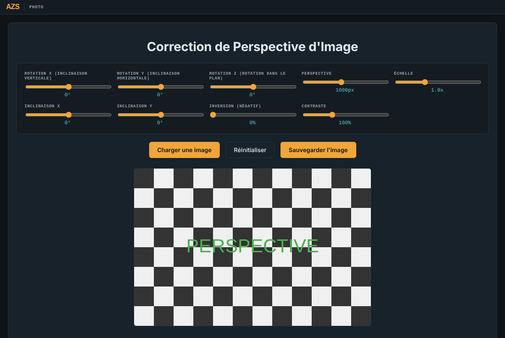
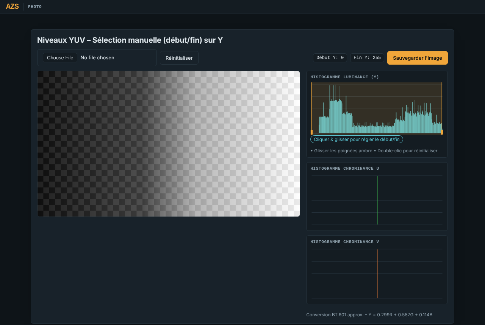
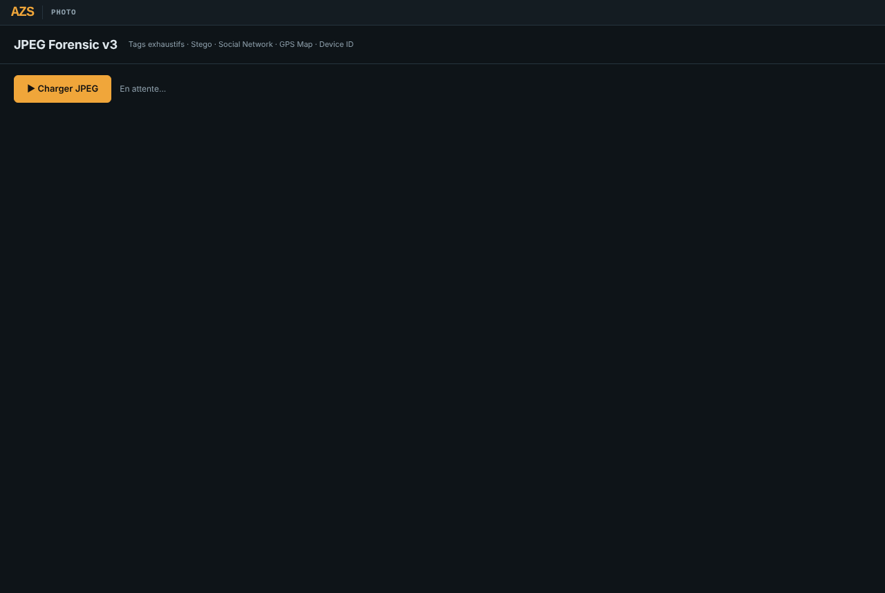
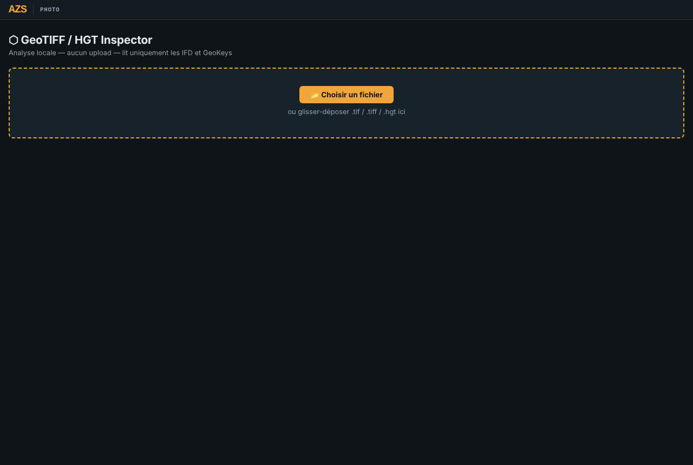
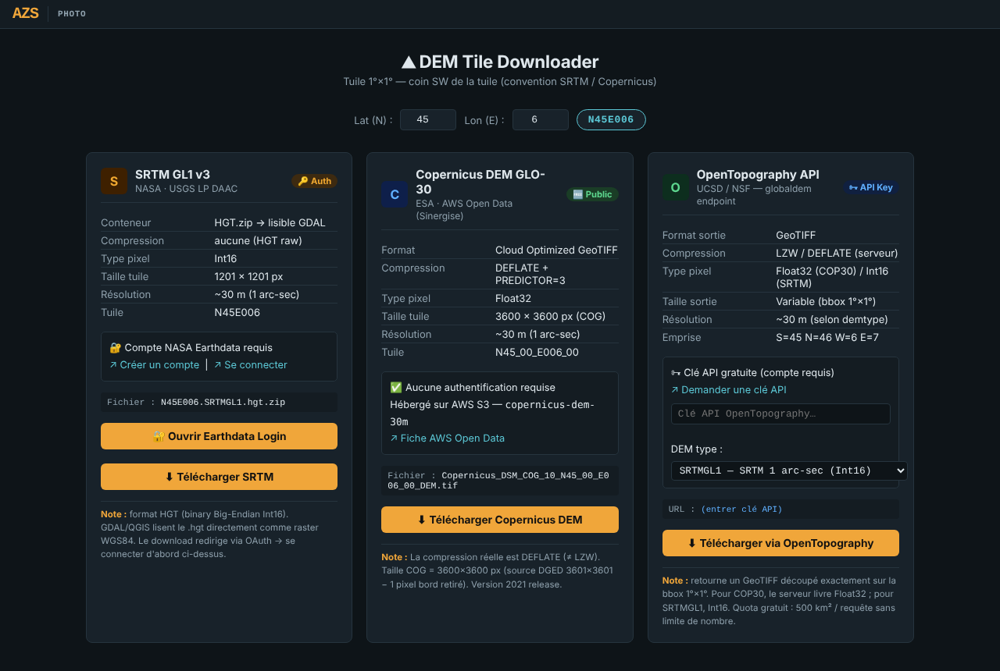
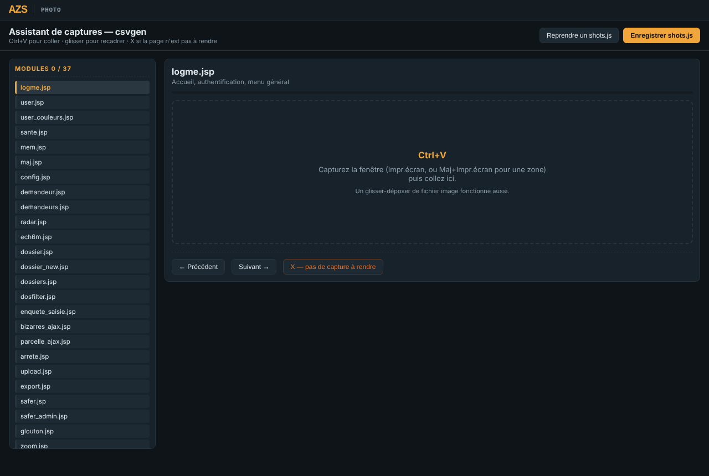

<!--
  Name     : README.md
  Purpose  : Overview of the photo repository (image and geodata tools in the browser)
  Author   : Eric Perret
  Date     : 2026-10-27
  License  : CC BY-NC 4.0
-->

# 📸 Photo

🇫🇷 [Version française : LISEZMOI.md](LISEZMOI.md)

Six standalone tools for images and geodata: one HTML file each, no library, no installation, files read on your computer (nothing is uploaded). User interfaces in French, except DEM Tile Downloader and GeoTIFF Inspector (English titles, French texts).

| Tool | Launch | Purpose |
|---|---|---|
| Perspective correction | ▶️ **[perspective-correction-filtres.html](https://ericperret.github.io/photo/perspective-correction-filtres.html)** | Straighten a photo and save it |
| YUV levels | ▶️ **[histogram-levels-yuv2.html](https://ericperret.github.io/photo/histogram-levels-yuv2.html)** | Adjust levels on luminance |
| JPEG Forensic v3 | ▶️ **[jpeg-forensic-v3.html](https://ericperret.github.io/photo/jpeg-forensic-v3.html)** | Analyse the structure and metadata of a JPEG |
| GeoTIFF / HGT Inspector | ▶️ **[geotiff_inspector.html](https://ericperret.github.io/photo/geotiff_inspector.html)** | Read the structure of a GeoTIFF or HGT |
| DEM Tile Downloader | ▶️ **[dem_downloader.html](https://ericperret.github.io/photo/dem_downloader.html)** | Download digital elevation model tiles |
| Screenshot assistant | ▶️ **[captures.html](https://ericperret.github.io/photo/captures.html)** | Prepare the screenshots of an organisation chart |

---

## Perspective correction

| Feature | Description |
|---|---|
| Geometry | X, Y, Z rotations, perspective, scale, X and Y skew, live |
| Filters | Invert (negative), contrast |
| Saving | PNG of the image as displayed: 3D projection (homography) and filters recomputed on the pixels, bilinear interpolation, transparent background outside the image |
| Reset | Back to neutral settings |

## YUV levels

| Feature | Description |
|---|---|
| Levels | Start / end bounds chosen by hand on the luminance (Y) histogram |
| Histograms | Luminance Y, chrominance U and V |
| Saving | PNG of the processed image |

## JPEG Forensic v3

| Feature | Description |
|---|---|
| Structure | JPEG markers (SOF, DHT, DQT…), dimensions, quantisation tables |
| Metadata | EXIF (IFD0, Exif, IFD1 and thumbnail), GPS with location, IPTC, XMP, MakerNote |
| Source platform | Detection from clues (stripped EXIF, ICC, quantisation tables, dimensions, XMP): Facebook, Instagram, Twitter / X, WhatsApp, Telegram, Discord, Snapchat, original or partly cleaned image, with a confidence level |

## GeoTIFF / HGT Inspector

| Feature | Description |
|---|---|
| Reading | TIFF IFDs, GeoKeys and GDAL tags, without loading the image |
| Formats | Classic TIFF, BigTIFF, COG, HGT |
| Output | Copyable text dump (for analysis or an AI) |

## DEM Tile Downloader

| Feature | Description |
|---|---|
| Tile | Latitude / longitude entry, named after the south-west corner (SRTM / Copernicus convention) |
| Providers | SRTM GL1 v3 (NASA Earthdata, account required), Copernicus DEM GLO-30 (AWS S3, open), OpenTopography (API key) |
| Links | Direct download links built for the tile |

## Screenshot assistant

Support tool for documenting the SEG973 platform (csvgen): walks through the module list of `organigramme.html`, waits for Ctrl+V, offers mouse cropping, a format and compression with a size preview, produces the `SHOTS` block to paste (`shots.js`), can resume work in progress and save each image.

---

## History

| Tool | Version | Change |
|---|---|---|
| Perspective correction | 1.1 | Saving fixed: the saved image was the unmodified original (settings applied in CSS only); download made reliable |
| YUV levels | 2.1 | Download made reliable |
| YUV levels | 2.3 | Neutral bounds (0 / 255) when an image is loaded and on reset: the image is no longer darkened by default and the handles match the displayed values |
| YUV levels | 2.4 | Y histogram handles: mouse position scaled to the canvas (displayed narrower than its 512 px); the right handle can be grabbed again and reaches 255 |
| All six tools | 2026-10-18 | AZS visual identity: slate / amber / cyan palette, AZS band linking back to www.azs.fr, dark theme for YUV levels and perspective correction; screenshots refreshed |

## License

**Free for non-commercial use** — [CC BY-NC 4.0](https://creativecommons.org/licenses/by-nc/4.0/), with mandatory credit of the source and the author:

> photo — Eric PERRET — https://github.com/ericperret/photo

Any commercial use is forbidden without the author's written permission, requested by e-mail: **eperret@azs.fr**.
Full terms (French / English): [LICENSE](LICENSE).

## Author

**Eric Perret** — [GitHub](https://github.com/ericperret)
